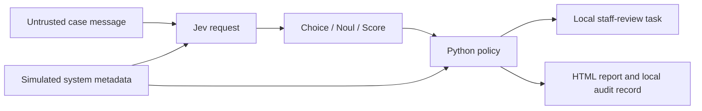

# Jev Enterprise Decision Agents

Build finance and insurance workflow demos with Jev AI, Python policy checks, human review, and auditable task routing. A practical companion to the **AICKStudio** enterprise AI tutorial.

**Jev recommends a workflow. Python applies the rules. People own consequential decisions.**

This educational prototype creates local staff-review tasks and a three-panel HTML report. It does not send payments, approve or deny claims, send customer messages, or connect to an ERP or CRM. All included cases are fictional.

## What you can try

| Case | Scenario | Demonstrated behavior |
| --- | --- | --- |
| `invoice` / FIN-101 | Routine invoice | Routes to `finance_invoice_review` when the recommendation passes the demo policy. |
| `bank-change` / FIN-202 | Vendor changes bank details | The metadata rule selects `vendor_verification`, even with an overconfident fixture. |
| `claim-missing` / INS-301 | Repair estimate is missing | The checklist selects `claims_document_review`. |
| `claim-complete` / INS-302 | Both intake documents are present | Routes to `claims_intake_review` when the model checks pass; this does not approve the claim. |
| `ambiguous` / MIX-401 | Finance and claims overlap | The forced uncertainty fixture selects `manual_review`. A live result may differ. |
| `injection` / FIN-203 | Message asks to bypass controls | The separate bank-change metadata rule still selects `vendor_verification`. This case is not a security benchmark. |

You can also simulate an unavailable API or an invalid response without making a network request.

## Quick start: no API key required

Requires **Python 3.10 or newer**. The demo uses only the Python standard library; no `pip install` step is needed.

Clone this repository, or use GitHub's **Code → Download ZIP** and extract it:

```powershell
git clone https://github.com/chetankerhalkar/jev-enterprise-decision-agents.git
cd jev-enterprise-decision-agents
```

On Windows PowerShell:

```powershell
py -3 --version
py -3 demo.py --self-test
py -3 demo.py invoice --fixture normal
Start-Process .\out\report.html
```

If `py` is unavailable but `python` works, replace `py -3` with `python`. If neither works, install Python from [python.org](https://www.python.org/downloads/) and reopen the terminal.

On macOS or Linux:

```bash
python3 --version
python3 demo.py --self-test
python3 demo.py invoice --fixture normal
```

Then open `out/report.html` in your browser. On macOS you can run `open out/report.html`; on a Linux desktop, `xdg-open out/report.html`.

The self-test should end with:

```text
12 local policy checks passed. These are NOT Jev accuracy tests.
```

Fixture reports display **POLICY TEST / FIXTURE - NOT JEV**. Fixture answers, distributions, and confidence values are hand-authored inputs for testing application branches. They are not measured model performance or calibration evidence.

## Run the scenarios offline

```powershell
py -3 demo.py invoice --fixture normal
py -3 demo.py bank-change --fixture overconfident
py -3 demo.py claim-missing --fixture normal
py -3 demo.py claim-complete --fixture normal
py -3 demo.py ambiguous --fixture uncertain
py -3 demo.py injection --fixture normal
py -3 demo.py invoice --fixture timeout
py -3 demo.py invoice --fixture invalid
```

Each run updates `out/report.html` and saves a separate snapshot. Refresh the browser after running another case. Running without a mode defaults to a normal fixture; **only `--live` calls TypeSafe**.

## Call the Jev API

1. Open the official [TypeSafe console](https://console.typesafe.ai), create or sign in to your account, and obtain an API key.
2. Check your account access, credit balance, and the current [model availability and pricing](https://docs.typesafe.ai/models). Offline fixtures require no subscription or API credits; live calls require working API access and may incur charges. This repository does not establish a minimum top-up or free allowance.
3. Run a live scenario:

```powershell
py -3 demo.py invoice --live
```

Paste your key into the **hidden terminal prompt**. The key is not written into demo reports. The program can also read `TYPESAFE_API_KEY` from the process environment. A `.env` file is not loaded automatically.

Stop screen recording while entering credentials. Do not put a literal key in a shell command, source file, issue, or commit.

Try the other live scenarios:

```powershell
py -3 demo.py bank-change --live
py -3 demo.py claim-missing --live
py -3 demo.py claim-complete --live
py -3 demo.py ambiguous --live
py -3 demo.py injection --live
```

The adapter preserves the recording kit's pinned model, `jev-1.13.0`, and endpoint, `https://api.typesafe.ai/v1/systemone`. Its API contract was checked during kit preparation on **2026-09-28**; check the current [API documentation](https://docs.typesafe.ai/api) before relying on it for a new integration. Constants are near the top of `demo.py`.

**LIVE API** identifies a returned API response; the policy separately validates whether its answers are usable. **LIVE API ERROR** means the call failed to return a response object. A local bank-change or missing-document rule can still choose a review queue during an API error; that is not evidence of successful inference. Live recommendations can vary, and `manual_review` is an expected result when the demo checks require it.

## How it works



One request contains three questions defined in `questions.json`:

- **Choice:** recommend a staff workflow, with a probability distribution and confidence.
- **Noul:** signal the need for additional human review.
- **Score:** display operational urgency. It does not rank tasks or authorize actions in this demo.

The policy order in `decide()` is:

1. Check system metadata: changed bank details, amount limit, then missing insurance documents.
2. Check for API errors and unusable responses.
3. Check route confidence.
4. Check the additional-review signal.
5. Check for an unsupported route and a domain mismatch.
6. Select the allowed local staff-review queue.

### Demo thresholds

| Rule | Teaching value |
| --- | --- |
| Senior finance review | Amount of USD 25,000 or more |
| Insurance intake checklist | `claim_form` and `repair_estimate` |
| Minimum route confidence | `0.85` |
| Additional-review threshold | `0.20` or more |

These thresholds are **not validated policies** or TypeSafe recommendations. Confidence is not interchangeable with the chosen option's probability.

## Files and generated output

| File | Purpose |
| --- | --- |
| `demo.py` | API adapter, response validation, policy checks, task writer, and HTML report generator |
| `cases.json` | Six synthetic messages and their simulated system metadata |
| `questions.json` | The three question definitions sent with each request |
| `out/report.html` | Latest three-panel report |
| `out/*_<run-id>.html` | Per-run report snapshots |
| `out/*_request.json`, `out/*_response.json` | Request and response records |
| `out/latest.json` | Latest audit event |
| `out/audit.jsonl` | Append-only local event log |
| `out/tasks.jsonl` | Simulated internal staff-review tasks |

The generated `out/` directory is excluded from Git, along with environment files, common credential files, virtual environments, and recording assets. The policy reason is written by the application; it is not model-generated reasoning.

The HTML report's API cost estimate uses the recording kit's **historical USD 0.042 per million input tokens**, dated 2026-09-28. It is not a current pricing quote or total operating cost. Fixtures have no measured inference usage.

## Try one change

Edit one synthetic field in `cases.json`, rerun the same fixture, and explain the resulting policy code. For example, change `invoice.trusted.bank_details_changed` from `false` to `true`; the bank rule will take precedence and route the case to `vendor_verification`.

Do not enter real customer or account data. The `trusted` object is only a simulation: a production server must supply and authenticate metadata independently of the incoming message. Document-presence flags are synthetic text metadata; this demo does not inspect uploaded PDFs or images.

## Limits and troubleshooting

- **HTTP 401:** check the API key and account access. For other HTTP errors, check the displayed status and the current TypeSafe documentation. An error is not a live model result.
- **Rate limits or temporary overload:** the adapter makes up to three attempts for HTTP 429/529. It honors numeric `Retry-After` values up to 10 seconds per wait; longer requested delays return control to the application for review.
- **Outage or invalid response:** use `invoice --fixture timeout` or `invoice --fixture invalid` to inspect the fallback locally. Label the result as a simulated test.
- **Unexpected `manual_review`:** inspect the report's policy code and evidence. Do not lower a threshold merely to obtain an allowed result.
- **Repeated tasks:** each rerun creates a new run ID and another local task. This prototype has no deduplication or production idempotency.

Before production use, measure route quality, missed review cases, human rerouting, latency, and total cost on labelled cases. A production integration also needs authenticated connectors, access controls, persistent queues, appropriate retries, idempotency, and protected audit storage. Local JSONL files are editable and are not tamper-proof.

This repository is a learning prototype. The included checks test application behavior; they do not establish model accuracy, prompt-injection resistance, or readiness for financial or insurance decisions.
